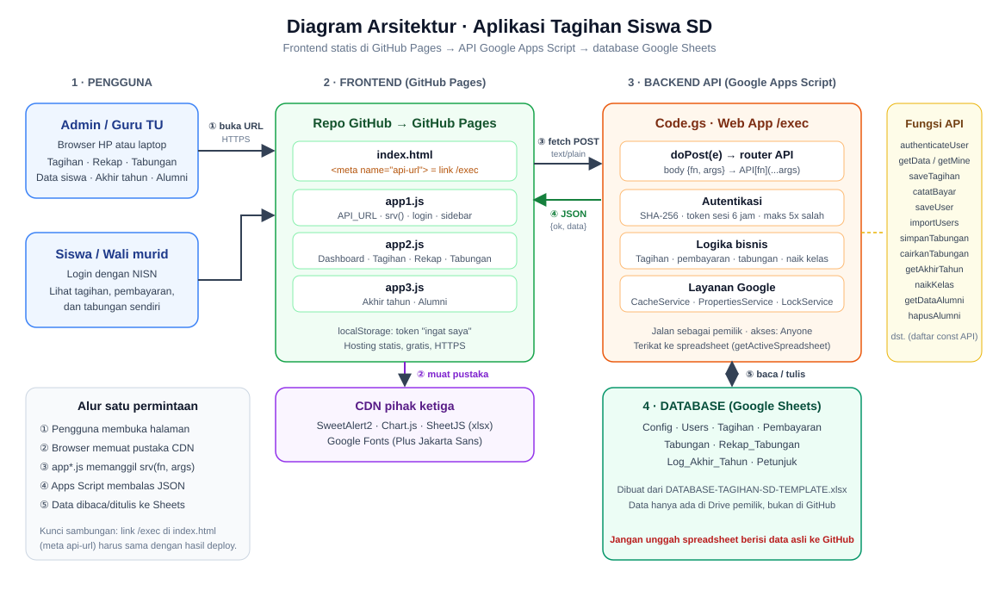
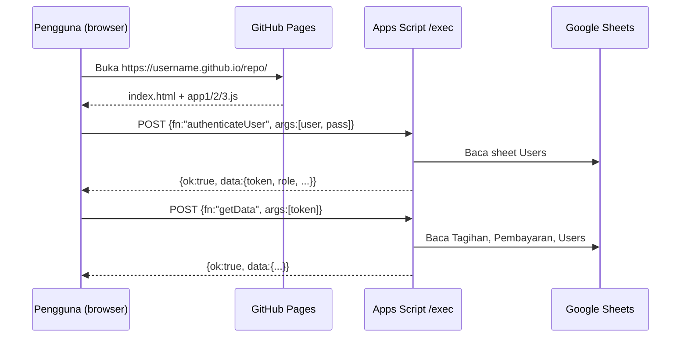

# Aplikasi Tagihan Siswa SD

Aplikasi web untuk mengelola tagihan sekolah dasar: tagihan bulanan dan tahunan, pencatatan pembayaran, tabungan siswa, kenaikan kelas otomatis, dan arsip alumni. Tanpa server berbayar:

- **Tampilan**: file statis (`src/index.html` + `app1.js`, `app2.js`, `app3.js`) di GitHub Pages
- **API**: Google Apps Script (`src/Code.gs`) yang di-deploy sebagai Web App
- **Database**: Google Sheets (dibuat dari `src/DATABASE-TAGIHAN-SD-TEMPLATE.xlsx`)



## Fitur

| Peran | Fitur |
|---|---|
| Admin / Guru TU | Dashboard, rekap pembayaran, kelola tagihan (termasuk salin dari tahun lalu), catat pembayaran, tabungan (setor, tarik, koreksi), data siswa, impor data, akhir tahun (naik kelas + kelulusan), menu Alumni (pelunasan, cetak, hapus), pengaturan sekolah |
| Siswa / Wali | Login dengan NISN, melihat tagihan, riwayat pembayaran, dan tabungan sendiri |

Fitur keamanan dasar: password disimpan sebagai hash SHA-256, token sesi berlaku 6 jam, login dibatasi 5 kali salah per 10 menit, dan ada opsi "ingat saya".

## Isi repositori

```
.
├── README.md                           # dokumentasi (halaman depan repo)
├── .gitignore
├── .github/
│   └── workflows/
│       └── pages.yml                   # otomatis menayangkan isi src/ ke GitHub Pages
└── src/
    ├── index.html                      # halaman utama (tempat link /exec diisi)
    ├── app1.js                         # inti: koneksi API, login, sidebar
    ├── app2.js                         # dashboard, tagihan, rekap, tabungan, siswa
    ├── app3.js                         # akhir tahun ajaran dan menu Alumni
    ├── Code.gs                         # backend Google Apps Script (ditempel manual)
    ├── DATABASE-TAGIHAN-SD-TEMPLATE.xlsx   # template database kosong
    └── docs/
        ├── arsitektur.svg              # diagram arsitektur
        └── arsitektur.png
```

Yang ditayangkan ke GitHub Pages hanya `index.html` dan `app1.js` sampai `app3.js`. `Code.gs` dan template xlsx tetap di repositori saja.

## Alur kerja



Sambungan antara frontend dan backend hanya satu: **link `/exec`** di baris `<meta name="api-url" ...>` pada `index.html`. `app1.js` membacanya ke `API_URL`, lalu semua fitur memanggil fungsi `srv(nama, ...args)` yang mengirim `POST` ke link itu. Di sisi Apps Script, `doPost` mencocokkan `fn` dengan daftar `const API` di `Code.gs`.

## Struktur database

| Sheet | Fungsi |
|---|---|
| `Config` | Nama yayasan, sekolah, alamat, kepala sekolah, guru TU, tahun ajaran, logo |
| `Users` | Akun admin dan siswa (siswa memakai NISN sebagai username) |
| `Tagihan` | Daftar tagihan per kelas dan tahun ajaran |
| `Pembayaran` | Riwayat pembayaran per siswa |
| `Tabungan` | Buku besar tabungan (hanya bertambah) |
| `Rekap_Tabungan` | Ringkasan tabungan per siswa per tahun ajaran |
| `Log_Akhir_Tahun` | Jejak kenaikan kelas dan kelulusan |
| `Petunjuk` | Catatan singkat |

Sheet `Tagihan`, `Pembayaran`, `Tabungan`, dan sheet lain diisi otomatis oleh aplikasi. Jangan diedit manual.

## Langkah pemasangan

Siapkan akun Google dan akun GitHub. Semua langkah gratis.

### 1. Buat database di Google Sheets

1. Buka [Google Drive](https://drive.google.com), klik **Baru → Upload file**, pilih `src/DATABASE-TAGIHAN-SD-TEMPLATE.xlsx`.
2. Klik dua kali file itu untuk membukanya, lalu **File → Simpan sebagai Google Spreadsheet**.
3. Ganti namanya, misalnya `DATABASE TAGIHAN SD`. Gunakan **file Google Sheets hasil konversi** untuk langkah berikutnya, bukan file `.xlsx`.

### 2. Pasang backend Apps Script

1. Di Google Sheets tadi, buka **Ekstensi → Apps Script**. Harus dibuka dari dalam spreadsheet karena kode memakai `getActiveSpreadsheet()`.
2. Hapus isi `Code.gs` bawaan, lalu tempel seluruh isi file `src/Code.gs` dari repositori ini. Simpan (ikon disket).
3. Pilih fungsi **`setup`** pada menu di atas editor, klik **Jalankan**. Setujui izin akses saat diminta (klik *Lanjutan → Buka ... (tidak aman)* bila Google memperingatkan; ini normal untuk skrip milik sendiri). `setup` melengkapi judul kolom, nilai awal Config, dan akun `admin`.

### 3. Deploy sebagai Web App

1. Klik **Deploy → Deployment baru**, ikon roda gigi → **Aplikasi web**.
2. Isi:
   - **Jalankan sebagai**: *Saya*
   - **Siapa yang memiliki akses**: *Siapa saja*
3. Klik **Deploy**, lalu **salin URL Aplikasi Web** yang berakhiran `/exec`.
4. Uji: tempel URL itu di tab browser. Harus muncul `{"ok":true,"data":"API Tagihan Siswa aktif"}`.

> Setiap kali `Code.gs` diubah, pilih **Deploy → Kelola deployment → ikon pensil → Versi: Versi baru → Deploy**. URL `/exec` tetap sama.

### 4. Isi link API di `index.html`

Buka `src/index.html`, cari baris ini (sekitar baris 7):

```html
<meta name="api-url" content="GANTI_DENGAN_LINK_EXEC_ANDA">
```

Ganti `GANTI_DENGAN_LINK_EXEC_ANDA` dengan URL `/exec` tadi, tanpa spasi tambahan:

```html
<meta name="api-url" content="https://script.google.com/macros/s/XXXXXXXX/exec">
```

### 5. Unggah ke GitHub dan aktifkan GitHub Pages

1. Buat repositori baru di GitHub (publik, agar GitHub Pages gratis bisa dipakai).
2. Unggah seluruh isi folder ini dengan struktur yang sama (`README.md` di luar, sisanya di `src/`, plus folder `.github/`). Cara paling mudah lewat terminal, karena folder tersembunyi `.github` ikut terbawa:
   ```bash
   git init
   git add .
   git commit -m "Aplikasi tagihan siswa"
   git branch -M main
   git remote add origin https://github.com/USERNAME/NAMA-REPO.git
   git push -u origin main
   ```
   Lewat web (**Add file → Upload files**) juga bisa dengan menyeret folder `src` dan `.github` sekaligus. Pastikan `.github/workflows/pages.yml` ikut terunggah.
3. Buka **Settings → Pages**. Pada *Build and deployment → Source*, pilih **GitHub Actions** (bukan "Deploy from a branch").
4. Buka tab **Actions**, tunggu workflow *Deploy ke GitHub Pages* selesai (centang hijau, sekitar 1 menit). Bila belum jalan, klik workflow itu lalu **Run workflow**.
5. Alamat aplikasi: `https://USERNAME.github.io/NAMA-REPO/`.

> Setiap kali Anda mengubah file di `src/` dan melakukan push ke `main`, situs diperbarui otomatis.

### 6. Login pertama dan pengaturan awal

1. Buka alamat GitHub Pages, pilih tab **Admin**, login dengan `admin` / `admin123`.
2. Segera ganti password lewat menu **Ganti password**.
3. Buka **Pengaturan**, isi nama yayasan, sekolah, alamat, kepala sekolah, guru TU, tahun ajaran, dan link logo (opsional).
4. Buka **Impor tagihan** atau **Data siswa** untuk memasukkan siswa. Password awal siswa baru adalah `123456`, dan siswa diminta menggantinya.
5. Buka menu **Tagihan** untuk membuat tagihan tahun ajaran berjalan.

## Alur akhir tahun ajaran

1. Buka menu **Akhir tahun**, periksa rencana kenaikan.
2. Klik **Naikkan semua kelas** dan ketik `KELULUSAN` untuk konfirmasi.
3. Siswa kelas 1 sampai 5 naik satu kelas, siswa kelas 6 pindah ke menu **Alumni**, tagihan lama diarsipkan, dan sisa tagihan dibawa sebagai tunggakan.
4. Buat tagihan tahun baru di menu **Tagihan** (bisa dengan tombol salin tagihan tahun lalu).

## Pemecahan masalah

| Gejala | Penyebab dan solusi |
|---|---|
| Muncul peringatan "Link server (/exec) belum terpasang" | `index.html` masih berisi `GANTI_DENGAN_LINK_EXEC_ANDA` atau link salah. Pastikan berakhiran `/exec`. |
| Login gagal terus padahal password benar | Jalankan `setup` di Apps Script. Pastikan sheet `Users` punya baris `admin`. Setelah 5 kali salah, tunggu 10 menit. |
| "Tidak bisa terhubung" atau error CORS | Deployment harus **Jalankan sebagai: Saya** dan **Akses: Siapa saja**. Setelah mengubah kode, buat **versi baru**. |
| Perubahan kode tidak berpengaruh | Deploy ulang sebagai versi baru (lihat catatan di langkah 3). |
| Halaman kosong setelah upload | Pastikan Settings → Pages memakai Source **GitHub Actions** dan workflow di tab Actions berhasil (centang hijau). Pastikan `index.html` dan `app1.js` sampai `app3.js` berada di folder `src/` yang sama. |
| Nomor NISN kehilangan angka 0 di depan | Kolom NISN harus berformat teks. `setup` mengatur ini. Jangan mengetik NISN langsung sebagai angka di sheet. |

## Keamanan dan privasi

- **Jangan mengunggah spreadsheet berisi data siswa asli ke GitHub.** Repositori ini hanya berisi template kosong. Data asli tetap di Google Drive pemilik.
- Link `/exec` bersifat publik karena tertulis di `index.html`. Pengamanan ada pada login: semua data hanya bisa diambil dengan token sesi yang sah.
- Jangan membagikan akses edit spreadsheet kepada orang yang tidak berwenang.
- Ganti password `admin` sebelum aplikasi dipakai.
- Zona waktu di `Code.gs` ditetapkan `Asia/Jakarta`. Ubah bila perlu.

## Teknologi

HTML, CSS, dan JavaScript tanpa framework · Google Apps Script · Google Sheets · [SweetAlert2](https://sweetalert2.github.io/) · [Chart.js](https://www.chartjs.org/) · [SheetJS](https://sheetjs.com/) · Google Fonts.
